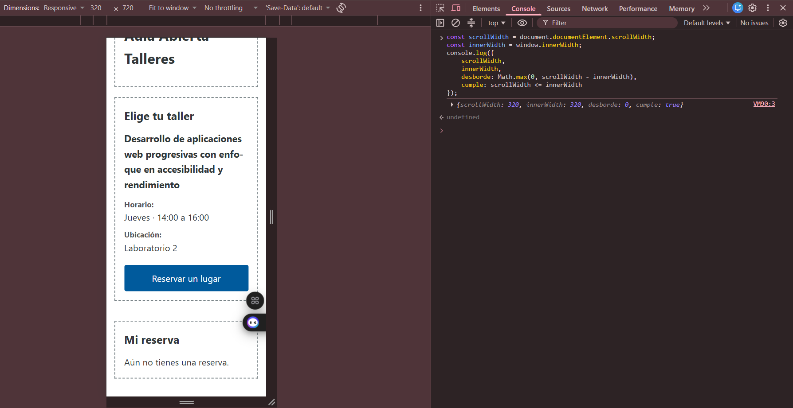
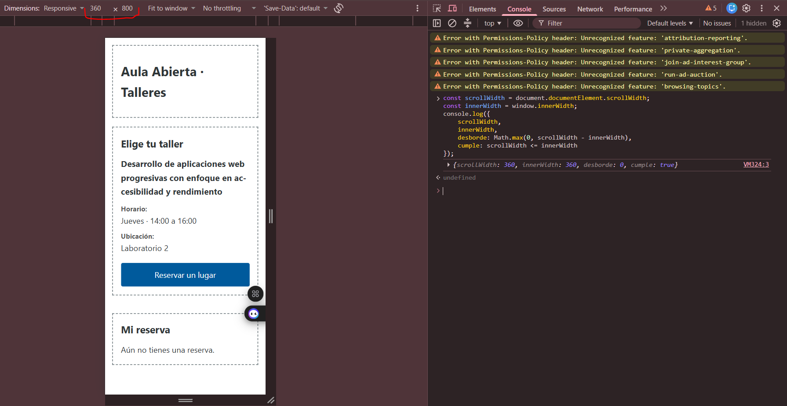
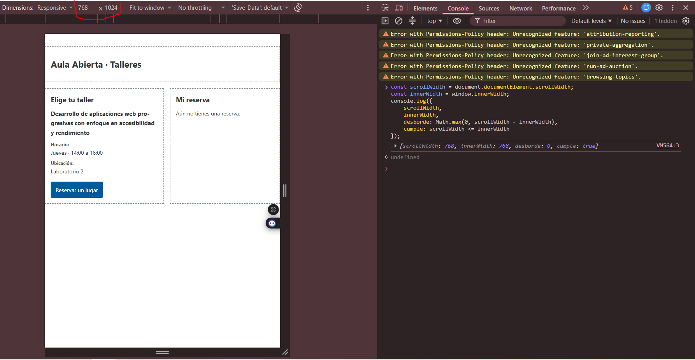
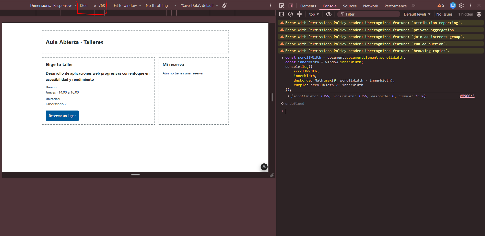

# Mediciones de Validación Responsive

### Resolución 320×720
- scrollWidth: 320
- innerWidth: 320
- Desborde: 0 px
- Cumple: TRUE

### Resolución 360×800
- scrollWidth: 360
- innerWidth: 360
- Desborde: 0 px
- Cumple: TRUE

### Resolución 768×1024
- scrollWidth: 768
- innerWidth: 768
- Desborde: 0 px
- Cumple: TRUE
- Layout: 2 columnas

### Resolución 1366×768
- scrollWidth: 1366
- innerWidth: 1366
- Desborde: . px
- Cumple: TRUE
- Layout: 2 columnas

## Observaciones
- Panel "Mi reserva" visible en móvil: Si
- Títulos largos sin romper diseño: Si
- Botones con tamaño táctil adecuado (44px mínimo): Si